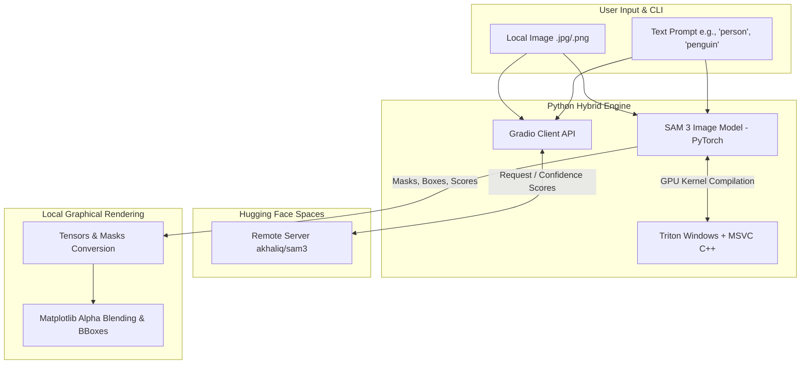

# sam3-concept-segmentation-pipeline

# 🎯 SAM 3: Segment Anything with Concepts (Local & Hybrid API)

[](https://www.python.org/)
[](https://pytorch.org/)
[](https://github.com/facebookresearch/sam3)
[](https://www.gradio.app/)
[](#video-demonstration)
[](#research-article--references)

Welcome to the **SAM 3 (Segment Anything Model 3)** project repository—a Python implementation showcasing **Promptable Concept Segmentation (PCS)** developed by Meta AI[cite: 4, 18, 21].

Developed as part of the **Image and Video Processing (Master's / Data Science Project)** curriculum at the Higher Institute of Computer Science and Multimedia of Sfax (ISIMS), this solution implements a **hybrid pipeline** combining local GPU inference (PyTorch + Triton on Windows) and remote API querying (Hugging Face / Gradio) to bypass hardware VRAM constraints while maintaining full local rendering control[cite: 30].

---

## 👨‍🎓 Team & Supervision

* **Authors:** Mohamed Neifar & Mahdi Neifar[cite: 4]
* **Supervisor:** Mr. Ali Wali[cite: 4]
* **Model Studied:** Meta SAM 3 (*Segment Anything Model 3*)[cite: 4, 21]

---

## 🎥 Video Demonstration

Watch the live demonstration of our SAM 3 segmentation pipeline in action—covering concept prompting, mask generation, and interactive segmentation[cite: 26]:

[](https://youtu.be/aGlFo6fFcEM)

> 🔗 **Direct Video Link:** https://youtu.be/aGlFo6fFcEM [cite: 26]
---

## 📚 Research Article & References

This implementation and our theoretical analysis are based on the official Meta AI research publication and resources:

* 📄 **Official Research Paper:** *SAM 3: Segment Anything with Concepts* — Meta AI Research (`Sam 3 Article.pdf` included in `docs/`).
* 📊 **Academic Presentation:** `Presentation SAM 3.pdf` — Detailed breakdown of PCS vs. traditional segmentation paradigms, architecture, and real-world use cases[cite: 4, 5].
* 💻 **Official Meta Repository & Hugging Face:** [facebookresearch/sam3](https://github.com/facebookresearch/sam3) | [Hugging Face Space (`akhaliq/sam3`)](https://huggingface.co/spaces/akhaliq/sam3)

---

## 🏛️ Pipeline Architecture

The system is engineered around a decoupled hybrid architecture that separates metadata and confidence score retrieval (via the remote server) from tensor computation and high-precision graphical rendering (locally)[cite: 30].



### Internal Architecture of SAM 3
Unlike SAM 1 and SAM 2, which required manual clicks or bounding boxes per object (*Promptable Visual Segmentation* - PVS), **SAM 3** introduces **PCS (*Promptable Concept Segmentation*)** powered by three core modules[cite: 18, 21, 22]:
1. **Perception Encoder (PE):** A unified vision-language backbone trained on 5.4 billion image-text pairs that aligns visual features with text embeddings from the ground up[cite: 22].
2. **Detector & Presence Head:** Based on the DETR architecture, the unique *Presence Head* globally predicts whether a requested concept exists in the image before attempting to localize boundaries, drastically reducing hallucinated masks and false positives[cite: 22, 23].
3. **Tracker & Memory Bank:** A dedicated video propagation module that stores past object appearances in a memory bank and applies temporal disambiguation to track spatio-temporal masks (*masklets*) across video frames even under occlusions[cite: 22, 24].

---

## ✨ Key Features

### 🖼️ Open-Vocabulary Concept Segmentation (Zero-Shot PCS)
* **Natural Language Prompts:** Automatically detects, segments, and tracks all instances of a concept described by a simple noun phrase (e.g., `"penguin"`, `"person"`, `"striped cat"`, `"hard hat"`) without any prior fine-tuning or fixed class vocabulary[cite: 18, 21, 23, 27].
* **Multi-Output Extraction:** Simultaneously outputs pixel-level **binary segmentation masks**, **bounding boxes**, and **confidence scores** for every detected instance[cite: 11, 21].

### ⚡ Windows Hardware & CUDA Optimization
* **Triton on Windows:** Integrates `triton-windows` alongside the MSVC C++ Build Tools compiler to JIT-compile critical custom GPU kernels (such as the *Euclidean Distance Transform - EDT* used in mask refinement).
* **Smart VRAM Management (6 GB GPU):** Optimizes local image inference while offloading heavy remote metadata checks to the Gradio API (`akhaliq/sam3`) to prevent `CUDA Out of Memory` crashes on 6 GB laptop GPUs.

### 🎨 Visualization & Post-Processing
* **Dynamic Alpha Blending:** Semi-transparent mask overlays with randomized per-instance colors and crisp bounding box frames rendered locally via `Matplotlib` and `NumPy`.
* **Interactive CLI Loop Mode:** Continuous terminal-based prompt execution allowing users to sequentially test multiple local images and concepts without reloading model weights into VRAM.

### 🌍 Real-World Use Cases
As covered in our architectural study, SAM 3's open-vocabulary segmentation directly powers[cite: 13]:
1. **Autonomous Vehicles:** Real-time road, lane, pedestrian, and obstacle parsing[cite: 13].
2. **Medical Imaging:** Anatomical structure and anomaly isolation[cite: 13].
3. **Satellite & Geospatial Analysis:** Land cover, infrastructure, and environmental monitoring[cite: 13].
4. **Multimedia & Video Editing:** Automated rotoscoping, background removal, and object tracking[cite: 13].
5. **Precision Agriculture & Industry:** Automated crop inspection, defect detection, and robotic grasping[cite: 13].

---

## 📊 Segmentation Paradigms Comparison

| Feature | Semantic Segmentation | Instance Segmentation | Panoptic Segmentation | **PCS (SAM 3)**[cite: 19] |
| :--- | :---: | :---: | :---: | :---: |
| **Function / Granularity** | Pixel-level class labels (merges same-class objects)[cite: 15, 19] | Delimits each distinct object instance (ignores background)[cite: 16, 19] | Combines semantic background & distinct object instances[cite: 17, 19] | **Detects, segments & tracks all instances of a concept**[cite: 19] |
| **Vocabulary** | Fixed (predefined classes)[cite: 19] | Fixed (predefined classes)[cite: 19] | Fixed (predefined classes)[cite: 19] | **Open Vocabulary (Free text / Exemplars)**[cite: 19] |
| **User Control** | None[cite: 19] | None[cite: 19] | None[cite: 19] | **Text prompts, points, boxes & exemplar images**[cite: 19, 23] |
| **Video Tracking** | No[cite: 19] | No[cite: 19] | No[cite: 19] | **Yes (Memory Bank & Temporal Disambiguation)**[cite: 19, 24] |

---

## 📂 Project Structure

```text
sam3-concept-segmentation-pipeline/
├── sam3/                        # Official Meta SAM 3 architecture source code
│   ├── model/                   # Image processors, encoders, trackers & EDT kernels
│   └── model_builder.py         # Image and video model builders
├── docs/                        # Reference paper (Sam 3 Article.pdf) & presentation slides (Presentation SAM 3.pdf)
├── main_hybrid.py               # Main script (Local PyTorch Inference + Gradio API Querying)
├── image_seg_local.py           # 100% local image segmentation & Matplotlib rendering script
├── video_seg.py                 # Video masklet propagation & OpenCV rendering script
├── requirements.txt             # Python project dependencies
└── README.md                    # Complete project documentation
```

---

## 🚀 Getting Started

Follow these steps to set up your environment, configure Windows GPU compilation, and run the project locally[cite: 30].

### 📋 Prerequisites
* **Operating System:** Windows 10 or Windows 11 (64-bit) with an NVIDIA GPU (CUDA 12.6 recommended).
* **C++ Compiler (Required for Triton):** Download and install [Visual Studio Build Tools](https://visualstudio.microsoft.com/visual-cpp-build-tools/) and select the **"Desktop development with C++"** workload, ensuring the following components are checked:
  * `MSVC v143 - VS 2022/2026 C++ x64/x86 build tools`
  * `Windows 10/11 SDK`
  * `C++ CMake tools for Windows`
* **Hugging Face Account:** Request and obtain access to the gated `facebook/sam3` repository on Hugging Face, then generate a **Read** access token (`hf_...`).

---

### 🛠️ Installation & Setup

#### Step 1: Create and Activate a Conda Environment
```bash
conda create -n sam3 python=3.12 -y
conda activate sam3
```

#### Step 2: Install PyTorch (CUDA 12.6) & Triton for Windows
```bash
pip install torch==2.7.0 torchvision torchaudio --index-url [https://download.pytorch.org/whl/cu126](https://download.pytorch.org/whl/cu126)
pip install triton-windows
```
*(Verify Triton installation with: `python -c "import triton; print(triton.__version__)"`)*

#### Step 3: Clone the Repository & Install Dependencies
```bash
git clone [https://github.com/Mohamed-Neifar/sam3-concept-segmentation-pipeline.git](https://github.com/Mohamed-Neifar/sam3-concept-segmentation-pipeline.git)
cd sam3-concept-segmentation-pipeline

# Clone official Meta SAM 3 source code if not already present
git clone [https://github.com/facebookresearch/sam3.git](https://github.com/facebookresearch/sam3.git) temp_sam3
# Ensure the inner 'sam3/' package directory is placed at the project root

# Install required Python libraries
pip install huggingface_hub transformers accelerate matplotlib opencv-python pillow gradio_client
```

#### Step 4: Authenticate with Hugging Face
Log in to your Hugging Face account in your terminal so PyTorch/SAM 3 can automatically download the gated model checkpoints:
```bash
python -c "from huggingface_hub import login; login()"
```
*(Paste your `hf_...` **Read** token when prompted and press Enter).*

---

### ▶️ Running the Application

1. Place your target images (e.g., `penguins.jpg`, `anas.jpg`) inside the root directory.
2. Launch the hybrid pipeline script from your terminal or IDE (PyCharm / VS Code):
```bash
python main_hybrid.py
```
3. Follow the interactive terminal prompts:
   * **Enter the image filename** (e.g., `penguins.jpg`).
   * **Enter the target concept** in English (e.g., `penguin`, `person`, `laptop`).
4. **Output:** The console displays the confidence scores and object counts retrieved from the Gradio API (`akhaliq/sam3`), while a `Matplotlib` window opens locally displaying your image with colored instance masks and red bounding boxes.

---

## ⚠️ Known Limitations & Challenges

Based on our technical evaluation of Meta's SAM 3 architecture, four main limitations were identified[cite: 27]:
1. **Specialized / Niche Domains:** Generalization drops on highly specialized concepts (e.g., complex medical terminology or specific aircraft variants) without domain-specific fine-tuning[cite: 27].
2. **Video Computational Cost:** Video inference speed decreases linearly as the number of simultaneously tracked objects increases, requiring high-VRAM GPUs (> 6 GB) for high-resolution streams[cite: 27].
3. **Linguistic Reasoning Complexity:** Optimized for concise noun phrases (e.g., `"striped cat"`); queries requiring multi-step spatial or logical reasoning require coupling SAM 3 with a Multimodal Large Language Model (MLLM)[cite: 27].
4. **Concept vs. Instance Interactivity:** Refining a single specific instance without affecting other instances of the same concept requires explicitly toggling between *Concept Mode* and *Instance Mode*[cite: 27].

---

## 📌 Notes
* Large model checkpoint files (`.pt` / `.safetensors`) and evaluation datasets (`SACO/Veval`) are excluded from this repository via `.gitignore` to keep the codebase lightweight and GitHub-friendly[cite: 30].
* This repository is developed for academic, research, and portfolio purposes[cite: 30].
